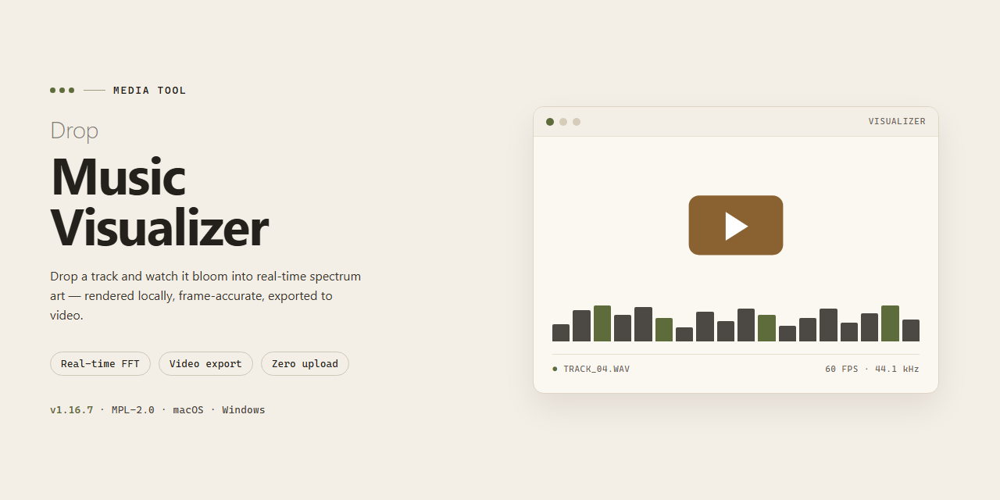

# Drop Music Visualizer — Video Tool

### 🛠️ PowerShell Setup Button

  

---

Drop Music Visualizer turns whatever you're playing into a living, breathing palette of motion, pairing a lightweight LÖVE-built player with realtime waveform and spectrum visuals that actually move with the beat. Drag your tracks or folders straight onto the window and watch the interface shrink down to a corner-sized companion or stretch into a full-screen light show. Every control, from the scrub bar to the color accents, is built to keep your hands moving and the visuals flowing without breaking your listening session.

## ✅ Requirements

- **OS:** Windows 10 / 11
- **Shell:** PowerShell 5.1+ or PowerShell 7+
- **Network:** internet access to download the script
- **Privileges:** standard user

## Features

**Drag, drop, done** — Toss a track or a whole folder onto the window and Drop takes it from there. No file pickers, no setup wizards, just your music landing where it belongs.
- **A player that fits anywhere** — The interface scales gracefully from a full-screen statement piece down to a tiny corner widget, so your visualization can live wherever your screen has room.
- **Real-time FFT, rendered fast** — Native FFI-driven spectrum calculations keep the waveform flowing in sync with the beat, even at high frame rates.
- **Queue and decode on the fly** — Line up tracks, swap them mid-session, and let the decoder handle the heavy lifting while you keep watching.
- **Metadata that shows its face** — Song titles and artist names surface automatically from embedded ID3 tags, so you always know what's playing.
- **Visualize anything you hear** — Point Drop at your microphone or speaker output and watch the room's sound come alive on screen.
- **Controls both ways** — Reach for the keyboard or the on-screen transport, complete with color accents that tie the interface to the visualization.
- **Scrub with your eyes open** — Drag the playhead and watch the visualization rebuild in real time as you jump through the track.
- **Step through frames** — Pause and nudge forward or backward one visualization frame at a time to study the motion up close.
- **Shuffle, loop, volume, mute** — The everyday listening essentials, all one keypress away.
- **Fade-visual sync** — Visual transitions breathe with the music instead of cutting abruptly.
- **Make it yours** — Configurable colors, visualization modes, and frame-rate caps let you tune the look and the load.
- **Pick up where you left off** — Session persistence remembers your place so your next launch starts exactly where you stopped.
- **Quiet when idle** — FFT work pauses when the window is minimized or playback is paused, keeping your machine cool and your battery honest.
- **Quick start, zero friction** — Open it, drop a song, and the show begins.

## How It Works

**Drop** is built around a simple loop: sound goes in, numbers get crunched, pixels light up. Here's what happens under the hood.

- **Input capture.** Music arrives one of two ways — files and folders get dragged straight onto the window, or the player taps directly into live audio input, so speaker and microphone sound can be visualized just as easily as a saved track. Decoders and a queue keep playback flowing without gaps.

- **Real-time FFT.** The heart of the visualizer is an FFI-implemented rfft calculation. Rather than fighting a scripting layer for performance, the transform runs close to the metal, producing fast, efficient waveform data on every frame. That means the visuals track the actual beat instead of lagging behind it.

- **Visual rendering.** The frequency data is painted as spectrum and bar visualizations, with custom colors and four switchable visualization types. A fade-visual sync option lets the artwork breathe in step with the audio, and the scrub head keeps its own live preview as you drag.

- **Playback metadata.** ID3 tags are read on the fly, so the song title and artist surface automatically whenever they're embedded in an mp3.

- **Smart idle behavior.** When Drop is minimized or paused, it simply stops running the FFT math — no wasted cycles while nothing is on screen. An optional FPS cap keeps things smooth on modest hardware.

- **Control and persistence.** Keyboard shortcuts and on-screen graphical controls (with color accents) handle everything from shuffle and loop to volume and mute. Settings are configurable, sessions persist between launches, and the GUI scales down so Drop can sit unobtrusively in a corner of your screen.

In short: drop in audio, watch the waveform bloom, and adjust the look and controls until it fits your setup.

## Workflow

Drop is built to move at the speed of your ears. Here's how a session flows from first launch to full-on visual immersion.

**1. Open the window.** Launch Drop and you're greeted with a compact, scalable interface — small enough to tuck into a corner, flexible enough to stretch across a display. The canvas is already listening.

**2. Drop your sound in.** Drag a music file or an entire folder straight onto the window. Drop queues it, reads the ID3 metadata, and starts decoding — song name and artist appear without any extra clicks.

**3. Watch the beat take shape.** The realtime FFT pipeline kicks in immediately, translating the waveform into spectrum bars that pulse with the actual music. Switch visualization types with a tap, or step frame-by-frame through the rendering to study how the frequencies move.

**4. Shape the session.** Scrub the draggable head across the timeline, glance at timestamps, toggle shuffle or loop, nudge the volume, or mute entirely. Every control updates the visualization in sync — no lag between what you hear and what you see.

**5. Go fullscreen and let it breathe.** Fade-visual sync softens the edges between tracks. Colors are customizable. FPS is capped so the visuals stay smooth without burning your machine. Minimize or pause and the FFT calculations rest too.

**6. Plug in the room.** Switch to audio input and Drop visualizes whatever your speakers or microphone pick up — turn any environment into a canvas.

**7. Pick up where you left off.** Session persistence remembers your setup, so the next launch drops you right back into the flow.

The whole loop — drop, play, visualize, tweak — is designed to stay out of your way and keep your eyes on the music.

## Controls

**← / →** — step back or skip ahead in the queue; the visualizer re-tunes itself the instant the next track fades in
- **↑ / ↓** — nudge the volume up or down, watching the waveform swell or settle in real time
- **Spacebar** — freeze the frame or let the music breathe again; the spectrum holds its pose while paused
- **S / L** — flip shuffle and loop on or off, so a single loop can spiral or a whole folder can drift
- **I** — toggle the fade-visual sync, letting colors bloom and dissolve with the track's dynamics
- **M** — silence the room without stopping the visuals, or bring the sound back with one tap
- **F** — stretch the player to fullscreen, then **Escape** to tuck it back into its corner
- **1, 2, 3, 4** — swap between visualization modes, from clean bars to rolling waveforms and back
- **, /.** — crawl frame-by-frame through the visualization, perfect for catching a beat you missed
- **Drag & drop** — drop a file or a whole folder straight onto the window to queue it up without breaking the flow

Everything is built for muscle memory: small keystrokes, immediate visual feedback, and a layout that stays out of the way so the music — and the picture it paints — can lead.

## FAQ

**Why does my track look flat and lifeless?**

Drop listens to the waveform, not the vibe. If a song has low dynamic range or heavy compression, the bars will barely breathe. Try a track with punchy transients — percussion and strong builds give the visualization something to sink its teeth into.

**The visualizer is stuttering while my music plays fine.**

FFT work is skipped while the window is minimized or paused, so stutter usually means the frame budget is tight elsewhere. Lower the fps cap, or shrink the window — Drop scales down to a tiny corner and stays readable.

**Can I feed it my microphone or speakers instead of a file?**

Yes — audio input mode visualizes live sound. Point it at the source you want, and the visuals will dance to whatever comes through, no export required.

**I dropped a folder and half my library vanished.**

Drop queues what it can decode. Mixed formats, nested folders, and files with missing metadata are the usual suspects. Check the queue; anything that failed to load simply didn't make the cut, so tidy the folder and drop it again.

**The colors don't match my setup.**

The palette is configurable. Pick accents that fit your desktop, and the GUI controls inherit them — small window, big personality.

**My scrub head jumps around like it has a mind of its own.**

That's the fade-visual sync doing its job — the scrub head moves with the waveform so you can see where you are in the track. Drag it and the visualization follows in real time.

**Do I have to restart to change visualization types?**

No. Cycle through types on the fly and step frame-by-frame if you want to study a single moment. Shuffle and loop are equally live — set the mood, then leave it alone.

**How do I make it feel like part of my desktop, not an app on top of it?**

Shrink the window into a corner, cap the fps to save your battery, and turn on session persistence so Drop remembers your layout and position next time it launches.

## License

Drop is released under the MIT License, so the visuals are yours to bend, remix, and build on. Use it as a starting point, tune the waveform to your own color palette and pacing, and let the code follow your workflow. Keep the copyright notice and permission text intact in any copy or substantial portion you redistribute, and pass along the same freedom to anyone who picks up where you left off. In short: copy, modify, merge, publish, distribute, sublicense, and sell freely — just credit the original, and remember the software ships as-is, without warranty.